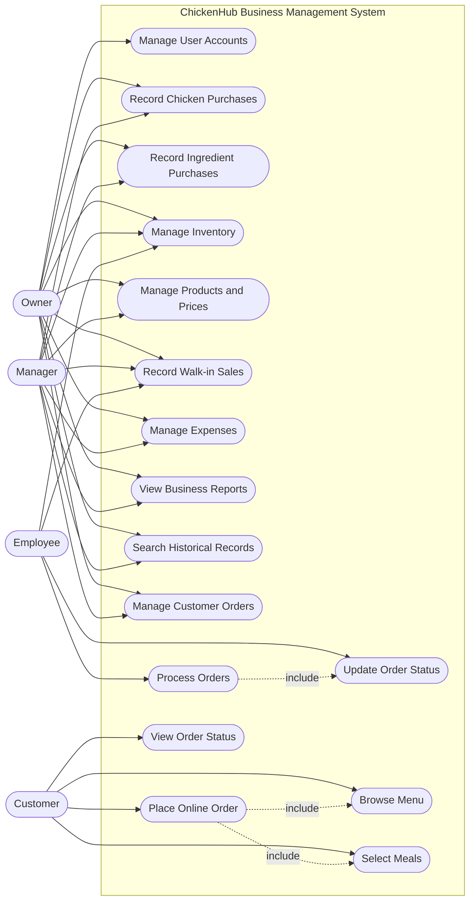

# 3.1 Use-Case Diagram
A use-case diagram will show the different users of ChickenHub (called actors) and the functions they can perform in the system.

Actors: Owner | Manager | Employee | Customer

# 3.1.1 ChickenHub use-case diagram

# 3.1.2 Explanation of the actors
**Actor           Main interactions**
Owner	        Controls users, purchasing, inventory, sales, expenses, reports and orders.
Manager	        Handles daily business operations and reviews business records.
Employee	    Records walk-in sales, assists with inventory and processes orders.
Customer	    Views the menu, selects meals, places orders and checks order status.

# 3.1.3 Explanation of the main use cases
- Purchasing management: Records chicken and ingredient purchases, including quantities, prices and discounts.
- Inventory management: Tracks stock received, used, sold and adjusted.
- Sales management: Records transactions from customers buying directly at the business.
- Expense management: Stores operational expenses.
- Historical records: Allows authorised users to search previously captured business information.
- Reports: Summarises business activity over selected periods.
- Online ordering: Allows customers to select meals and submit collection orders.
- Order management: Allows employees to process orders and update their statuses.